# Dataset category count report

Counts below preserve each source's native label scheme. Rows are not
cross-source comparable unless an explicit harmonization is documented.

## acevedo · v1 · not-reported · cell-category

Count basis: `decodable-images`; total: **17,092**; role: `external-holdout`.

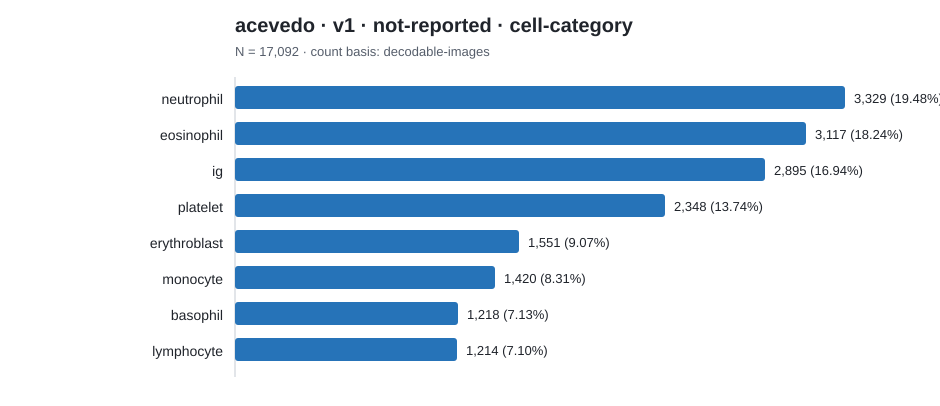

| Native category | Count | Share |
|---|---:|---:|
| neutrophil | 3,329 | 19.48% |
| eosinophil | 3,117 | 18.24% |
| ig | 2,895 | 16.94% |
| platelet | 2,348 | 13.74% |
| erythroblast | 1,551 | 9.07% |
| monocyte | 1,420 | 8.31% |
| basophil | 1,218 | 7.13% |
| lymphocyte | 1,214 | 7.10% |

## aml-matek · v1 · not-reported · cell-morphology

Count basis: `annotation-records`; total: **18,365**; role: `cohort-source`.

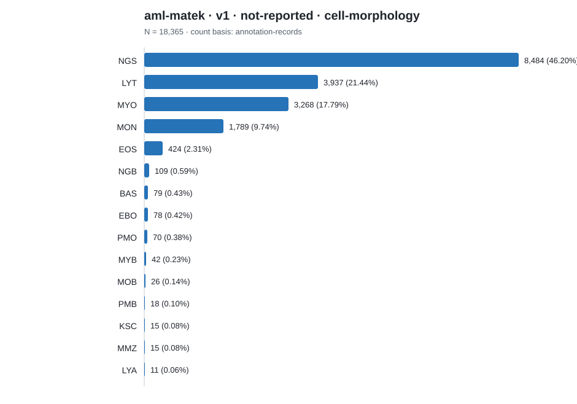

| Native category | Count | Share |
|---|---:|---:|
| NGS | 8,484 | 46.20% |
| LYT | 3,937 | 21.44% |
| MYO | 3,268 | 17.79% |
| MON | 1,789 | 9.74% |
| EOS | 424 | 2.31% |
| NGB | 109 | 0.59% |
| BAS | 79 | 0.43% |
| EBO | 78 | 0.42% |
| PMO | 70 | 0.38% |
| MYB | 42 | 0.23% |
| MOB | 26 | 0.14% |
| PMB | 18 | 0.10% |
| KSC | 15 | 0.08% |
| MMZ | 15 | 0.08% |
| LYA | 11 | 0.06% |

## apl-aml · Kaggle snapshot 2020-07-09 · all-patients · patient-level-diagnosis

Count basis: `patients`; total: **106**; role: `cohort-source`.

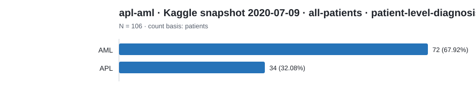

| Native category | Count | Share |
|---|---:|---:|
| AML | 72 | 67.92% |
| APL | 34 | 32.08% |

## apl-aml · Kaggle snapshot 2020-07-09 · signed-slides · cell-morphology-classification

Count basis: `decodable-jpg-files-in-native-class-folder`; total: **15,632**; role: `cohort-source`.

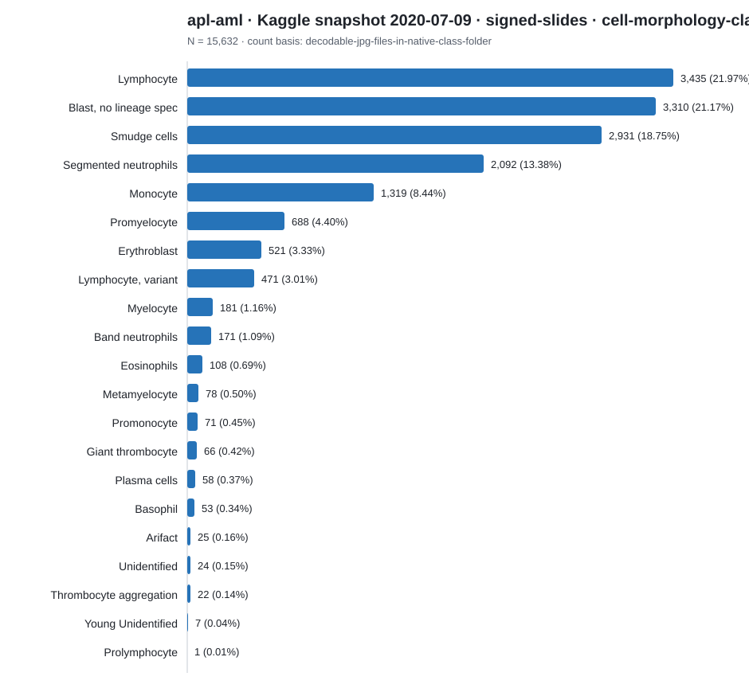

| Native category | Count | Share |
|---|---:|---:|
| Lymphocyte | 3,435 | 21.97% |
| Blast, no lineage spec | 3,310 | 21.17% |
| Smudge cells | 2,931 | 18.75% |
| Segmented neutrophils | 2,092 | 13.38% |
| Monocyte | 1,319 | 8.44% |
| Promyelocyte | 688 | 4.40% |
| Erythroblast | 521 | 3.33% |
| Lymphocyte, variant | 471 | 3.01% |
| Myelocyte | 181 | 1.16% |
| Band neutrophils | 171 | 1.09% |
| Eosinophils | 108 | 0.69% |
| Metamyelocyte | 78 | 0.50% |
| Promonocyte | 71 | 0.45% |
| Giant thrombocyte | 66 | 0.42% |
| Plasma cells | 58 | 0.37% |
| Basophil | 53 | 0.34% |
| Arifact | 25 | 0.16% |
| Unidentified | 24 | 0.15% |
| Thrombocyte aggregation | 22 | 0.14% |
| Young Unidentified | 7 | 0.04% |
| Prolymphocyte | 1 | 0.01% |

## aslan · github-master · all · object-detection

Count basis: `bounding-box-annotations`; total: **2,339**; role: `cohort-source`.

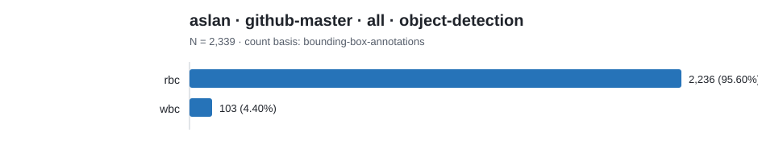

| Native category | Count | Share |
|---|---:|---:|
| rbc | 2,236 | 95.60% |
| wbc | 103 | 4.40% |

## bccd · Kaggle dataset snapshot 2022-12-21 · all · object-detection

Count basis: `bounding-box-annotations`; total: **4,888**; role: `cohort-source`.

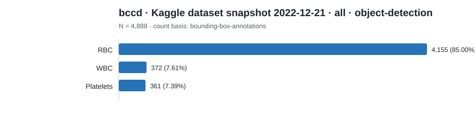

| Native category | Count | Share |
|---|---:|---:|
| RBC | 4,155 | 85.00% |
| WBC | 372 | 7.61% |
| Platelets | 361 | 7.39% |

## krd-wbc · v2 · all · cell-type-segmentation

Count basis: `labeled-images`; total: **600**; role: `cohort-source`.

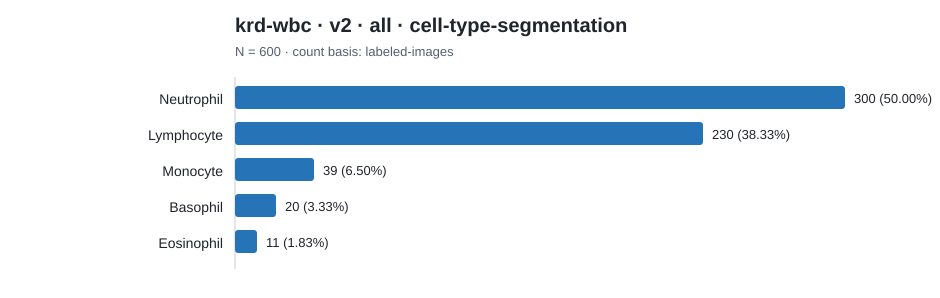

| Native category | Count | Share |
|---|---:|---:|
| Neutrophil | 300 | 50.00% |
| Lymphocyte | 230 | 38.33% |
| Monocyte | 39 | 6.50% |
| Basophil | 20 | 3.33% |
| Eosinophil | 11 | 1.83% |

## raabin-wbc · Train · train · cell-type-classification

Count basis: `decodable-images`; total: **10,175**; role: `cohort-source`.

| Native category | Count | Share |
|---|---:|---:|
| Neutrophil | 6,231 | 61.24% |
| Lymphocyte | 2,427 | 23.85% |
| Eosinophil | 744 | 7.31% |
| Monocyte | 561 | 5.51% |
| Basophil | 212 | 2.08% |

## ssl-seg · github-master · dataset-1 · cell-type-segmentation

Count basis: `labeled-images`; total: **300**; role: `cohort-source`.

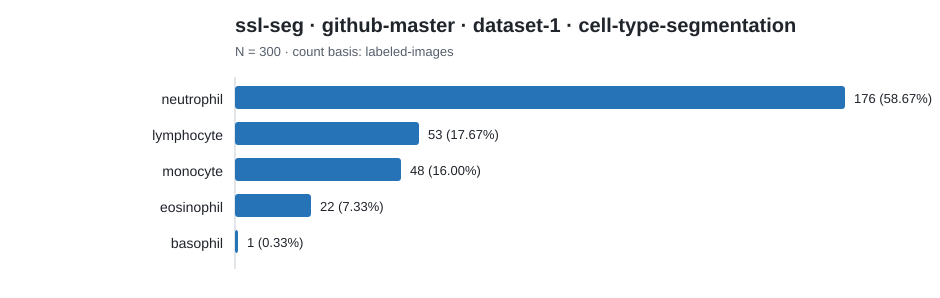

| Native category | Count | Share |
|---|---:|---:|
| neutrophil | 176 | 58.67% |
| lymphocyte | 53 | 17.67% |
| monocyte | 48 | 16.00% |
| eosinophil | 22 | 7.33% |
| basophil | 1 | 0.33% |

## ssl-seg · github-master · dataset-2 · cell-type-segmentation

Count basis: `labeled-images`; total: **100**; role: `cohort-source`.

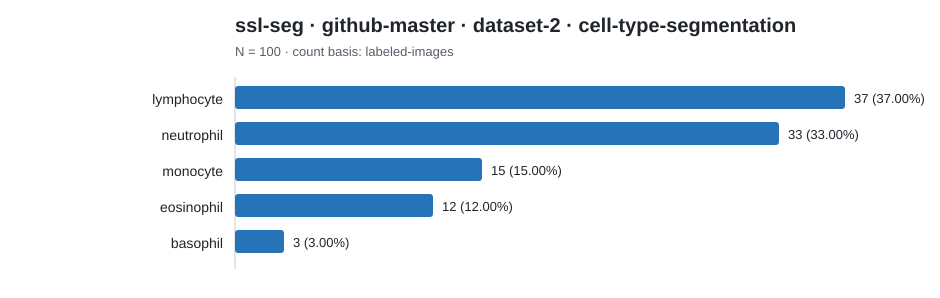

| Native category | Count | Share |
|---|---:|---:|
| lymphocyte | 37 | 37.00% |
| neutrophil | 33 | 33.00% |
| monocyte | 15 | 15.00% |
| eosinophil | 12 | 12.00% |
| basophil | 3 | 3.00% |

## warty-pig · public-drive-snapshot-2026-10-15 · augmented · cell-type-classification

Count basis: `directory-labelled-image-files`; total: **1,464**; role: `cohort-source`.

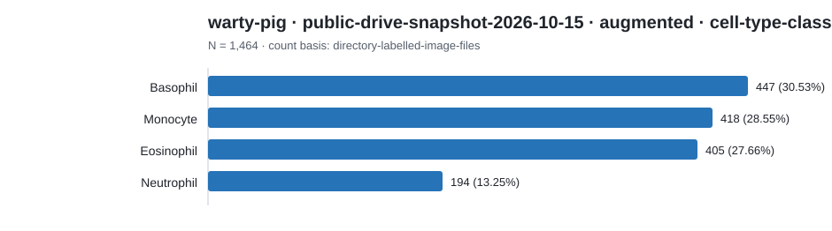

| Native category | Count | Share |
|---|---:|---:|
| Basophil | 447 | 30.53% |
| Monocyte | 418 | 28.55% |
| Eosinophil | 405 | 27.66% |
| Neutrophil | 194 | 13.25% |

## warty-pig · public-drive-snapshot-2026-10-15 · cropped-classified · cell-type-classification

Count basis: `directory-labelled-image-files`; total: **1,408**; role: `cohort-source`.

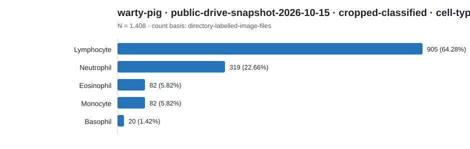

| Native category | Count | Share |
|---|---:|---:|
| Lymphocyte | 905 | 64.28% |
| Neutrophil | 319 | 22.66% |
| Eosinophil | 82 | 5.82% |
| Monocyte | 82 | 5.82% |
| Basophil | 20 | 1.42% |
