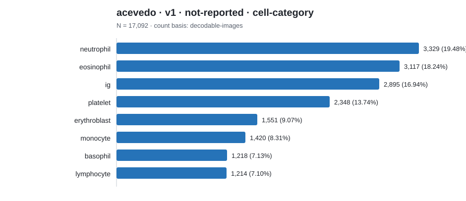

# Dataset category count report

Counts below preserve each source's native label scheme. Rows are not
cross-source comparable unless an explicit harmonization is documented.

## acevedo · v1 · not-reported · cell-category

Count basis: `decodable-images`; total: **17,092**; role: `external-holdout`.

| Native category | Count | Share |
|---|---:|---:|
| neutrophil | 3,329 | 19.48% |
| eosinophil | 3,117 | 18.24% |
| ig | 2,895 | 16.94% |
| platelet | 2,348 | 13.74% |
| erythroblast | 1,551 | 9.07% |
| monocyte | 1,420 | 8.31% |
| basophil | 1,218 | 7.13% |
| lymphocyte | 1,214 | 7.10% |
