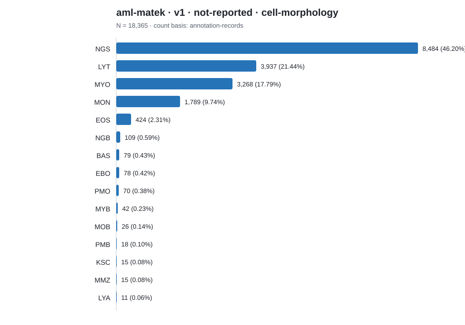

# Dataset category count report

Counts below preserve each source's native label scheme. Rows are not
cross-source comparable unless an explicit harmonization is documented.

## aml-matek · v1 · not-reported · cell-morphology

Count basis: `annotation-records`; total: **18,365**; role: `cohort-source`.

| Native category | Count | Share |
|---|---:|---:|
| NGS | 8,484 | 46.20% |
| LYT | 3,937 | 21.44% |
| MYO | 3,268 | 17.79% |
| MON | 1,789 | 9.74% |
| EOS | 424 | 2.31% |
| NGB | 109 | 0.59% |
| BAS | 79 | 0.43% |
| EBO | 78 | 0.42% |
| PMO | 70 | 0.38% |
| MYB | 42 | 0.23% |
| MOB | 26 | 0.14% |
| PMB | 18 | 0.10% |
| KSC | 15 | 0.08% |
| MMZ | 15 | 0.08% |
| LYA | 11 | 0.06% |
