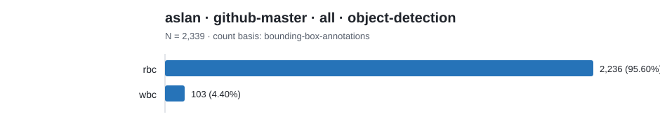

# Dataset category count report

Counts below preserve each source's native label scheme. Rows are not
cross-source comparable unless an explicit harmonization is documented.

## aslan · github-master · all · object-detection

Count basis: `bounding-box-annotations`; total: **2,339**; role: `cohort-source`.

| Native category | Count | Share |
|---|---:|---:|
| rbc | 2,236 | 95.60% |
| wbc | 103 | 4.40% |
