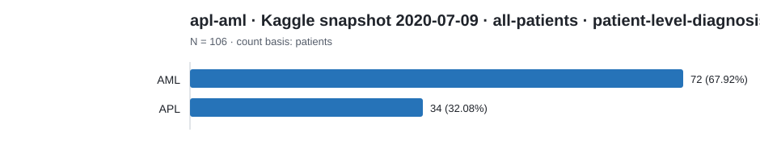
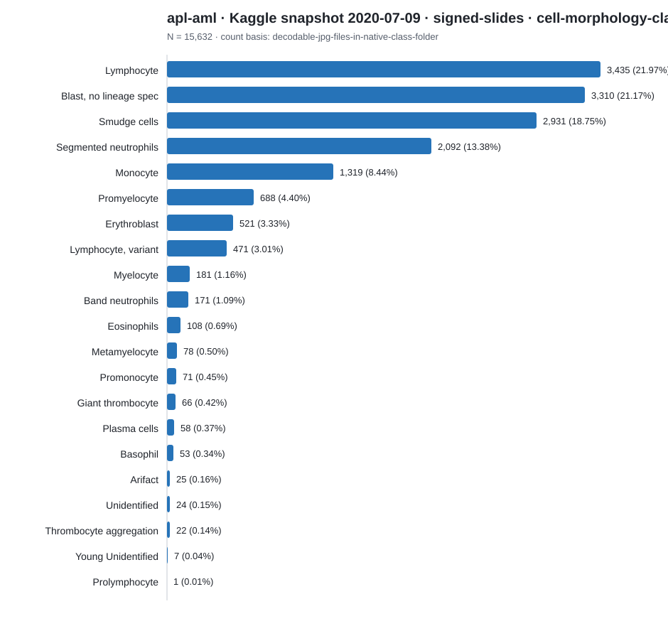
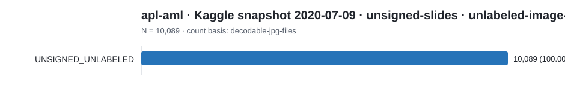
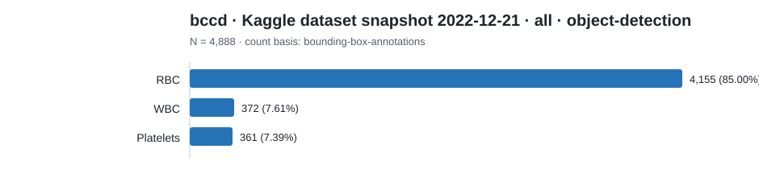

# Dataset category count report

Counts below preserve each source's native label scheme. Rows are not
cross-source comparable unless an explicit harmonization is documented.

## apl-aml · Kaggle snapshot 2020-07-09 · all-patients · patient-level-diagnosis

Count basis: `patients`; total: **106**; role: `cohort-source`.

| Native category | Count | Share |
|---|---:|---:|
| AML | 72 | 67.92% |
| APL | 34 | 32.08% |

## apl-aml · Kaggle snapshot 2020-07-09 · signed-slides · cell-morphology-classification

Count basis: `decodable-jpg-files-in-native-class-folder`; total: **15,632**; role: `cohort-source`.

| Native category | Count | Share |
|---|---:|---:|
| Lymphocyte | 3,435 | 21.97% |
| Blast, no lineage spec | 3,310 | 21.17% |
| Smudge cells | 2,931 | 18.75% |
| Segmented neutrophils | 2,092 | 13.38% |
| Monocyte | 1,319 | 8.44% |
| Promyelocyte | 688 | 4.40% |
| Erythroblast | 521 | 3.33% |
| Lymphocyte, variant | 471 | 3.01% |
| Myelocyte | 181 | 1.16% |
| Band neutrophils | 171 | 1.09% |
| Eosinophils | 108 | 0.69% |
| Metamyelocyte | 78 | 0.50% |
| Promonocyte | 71 | 0.45% |
| Giant thrombocyte | 66 | 0.42% |
| Plasma cells | 58 | 0.37% |
| Basophil | 53 | 0.34% |
| Arifact | 25 | 0.16% |
| Unidentified | 24 | 0.15% |
| Thrombocyte aggregation | 22 | 0.14% |
| Young Unidentified | 7 | 0.04% |
| Prolymphocyte | 1 | 0.01% |

## apl-aml · Kaggle snapshot 2020-07-09 · unsigned-slides · unlabeled-image-pool

Count basis: `decodable-jpg-files`; total: **10,089**; role: `cohort-source`.

| Native category | Count | Share |
|---|---:|---:|
| UNSIGNED_UNLABELED | 10,089 | 100.00% |

## bccd · Kaggle dataset snapshot 2022-12-21 · all · object-detection

Count basis: `bounding-box-annotations`; total: **4,888**; role: `cohort-source`.

| Native category | Count | Share |
|---|---:|---:|
| RBC | 4,155 | 85.00% |
| WBC | 372 | 7.61% |
| Platelets | 361 | 7.39% |
