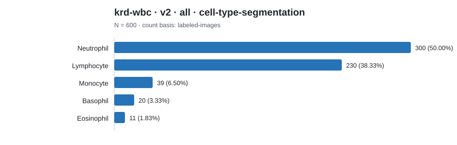

# Dataset category count report

Counts below preserve each source's native label scheme. Rows are not
cross-source comparable unless an explicit harmonization is documented.

## krd-wbc · v2 · all · cell-type-segmentation

Count basis: `labeled-images`; total: **600**; role: `cohort-source`.

| Native category | Count | Share |
|---|---:|---:|
| Neutrophil | 300 | 50.00% |
| Lymphocyte | 230 | 38.33% |
| Monocyte | 39 | 6.50% |
| Basophil | 20 | 3.33% |
| Eosinophil | 11 | 1.83% |
