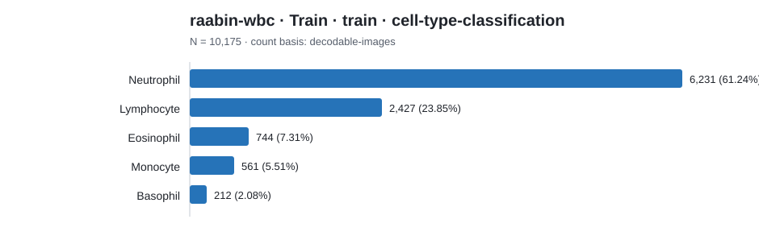

# Dataset category count report

Counts below preserve each source's native label scheme. Rows are not
cross-source comparable unless an explicit harmonization is documented.

## raabin-wbc · Train · train · cell-type-classification

Count basis: `decodable-images`; total: **10,175**; role: `cohort-source`.

| Native category | Count | Share |
|---|---:|---:|
| Neutrophil | 6,231 | 61.24% |
| Lymphocyte | 2,427 | 23.85% |
| Eosinophil | 744 | 7.31% |
| Monocyte | 561 | 5.51% |
| Basophil | 212 | 2.08% |
