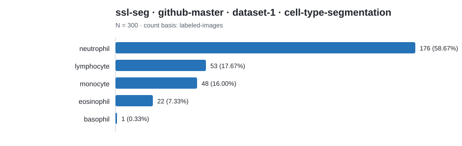
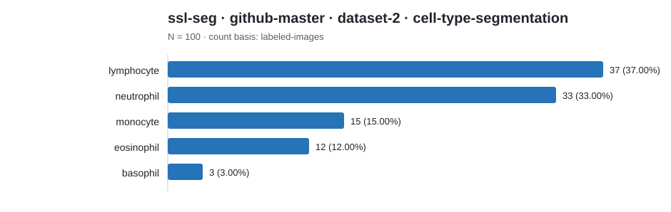

# Dataset category count report

Counts below preserve each source's native label scheme. Rows are not
cross-source comparable unless an explicit harmonization is documented.

## ssl-seg · github-master · dataset-1 · cell-type-segmentation

Count basis: `labeled-images`; total: **300**; role: `cohort-source`.

| Native category | Count | Share |
|---|---:|---:|
| neutrophil | 176 | 58.67% |
| lymphocyte | 53 | 17.67% |
| monocyte | 48 | 16.00% |
| eosinophil | 22 | 7.33% |
| basophil | 1 | 0.33% |

## ssl-seg · github-master · dataset-2 · cell-type-segmentation

Count basis: `labeled-images`; total: **100**; role: `cohort-source`.

| Native category | Count | Share |
|---|---:|---:|
| lymphocyte | 37 | 37.00% |
| neutrophil | 33 | 33.00% |
| monocyte | 15 | 15.00% |
| eosinophil | 12 | 12.00% |
| basophil | 3 | 3.00% |
