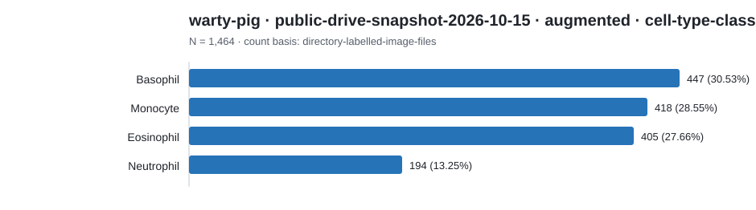
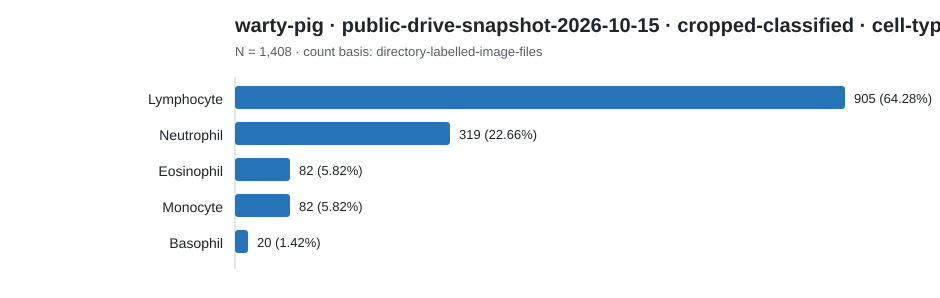

# Dataset category count report

Counts below preserve each source's native label scheme. Rows are not
cross-source comparable unless an explicit harmonization is documented.

## warty-pig · public-drive-snapshot-2026-10-15 · augmented · cell-type-classification

Count basis: `directory-labelled-image-files`; total: **1,464**; role: `cohort-source`.

| Native category | Count | Share |
|---|---:|---:|
| Basophil | 447 | 30.53% |
| Monocyte | 418 | 28.55% |
| Eosinophil | 405 | 27.66% |
| Neutrophil | 194 | 13.25% |

## warty-pig · public-drive-snapshot-2026-10-15 · cropped-classified · cell-type-classification

Count basis: `directory-labelled-image-files`; total: **1,408**; role: `cohort-source`.

| Native category | Count | Share |
|---|---:|---:|
| Lymphocyte | 905 | 64.28% |
| Neutrophil | 319 | 22.66% |
| Eosinophil | 82 | 5.82% |
| Monocyte | 82 | 5.82% |
| Basophil | 20 | 1.42% |
